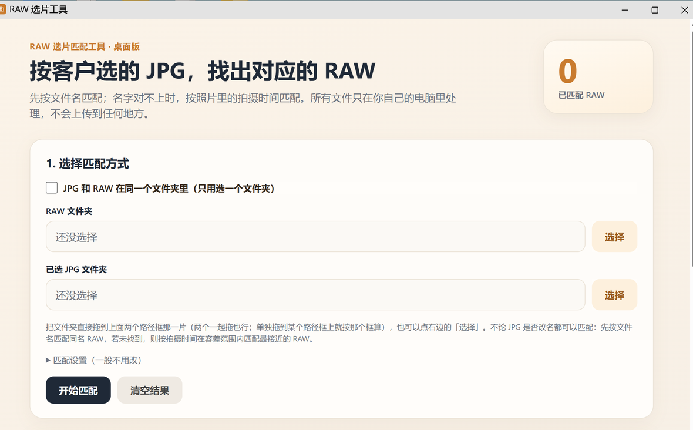

# RAW 选片工具

按客户挑出来的 JPG，把对应的 RAW 原片一次性挑出来。

桌面小工具：Windows 出单文件 exe，macOS 出通用版 DMG；另有一份纯网页版 HTML，任意系统双击即用。全部在本机完成，不联网、不上传任何文件。



## 下载

| 平台 / 形态 | 直链（恒定指向最新版） | 国内加速镜像 |
|---|---|---|
| **Windows 10/11 64 位** · v1.0 · 8.2 MB | **[⬇ exe](https://github.com/sq907259434/raw-matcher/releases/latest/download/RAWMatcher-v1.0-win64.exe)** | [镜像](https://ghfast.top/https://github.com/sq907259434/raw-matcher/releases/download/v1.0/RAWMatcher-v1.0-win64.exe) |
| **macOS 通用版** · v1.3 · 0.7 MB | **[⬇ dmg](https://github.com/sq907259434/raw-matcher/releases/latest/download/RAWMatcher-1.3-macos-universal.dmg)** | [镜像](https://ghfast.top/https://github.com/sq907259434/raw-matcher/releases/download/v1.0/RAWMatcher-1.3-macos-universal.dmg) |
| **纯网页版** · 任意系统 · 43 KB | **[⬇ html](https://github.com/sq907259434/raw-matcher/releases/latest/download/RAWMatcher-web.html)** | [镜像](https://ghfast.top/https://github.com/sq907259434/raw-matcher/releases/download/v1.0/RAWMatcher-web.html) |

[发布页](https://github.com/sq907259434/raw-matcher/releases/latest)里有完整的更新说明和三个校验值。国内直连 GitHub 下载容易卡住，用镜像列（同一个文件，已核对 SHA-256）。

**网页版不用安装**：把 HTML 存到本机，用 Chrome / Edge 双击打开就能用，Mac / Linux / Windows 都行。功能一致（含同文件夹模式、按文件名和拍摄时间匹配、导出），只是浏览器出于安全不给文件夹的完整路径、复制走文件接口会慢一点。详见[与纯网页版的区别](#与纯网页版的区别)。

两个桌面包都没买代码签名证书，第一次打开系统会有安全提示，属正常：

- Windows：弹「Windows 已保护你的电脑」→「更多信息」→「仍要运行」
- macOS：若提示「无法验证开发者」→ **右键点 App → 打开 → 再点「打开」**（或到「系统设置 → 隐私与安全性」里点「仍要打开」）
- 网页版：无签名问题，浏览器可能要确认「允许访问文件夹」，点允许即可

核对完整性用 SHA-256：

```
Windows exe  7da6c7c95b0c02c03ec01644c431a68db7b740b6f6d774ecfd31cc3d50e491e5
macOS  dmg   95dfed3fbec1972dc80002460c15b6aeeade698f3e4c46bea619b42f0a54e15c
网页版 html  ef5ebdb7fd9a764811a85cb757cd80d3011cb79442949e05bff2701ca7aeee36
```

## 它解决什么问题

拍完一场，客户在 JPG 里挑了几十张，你需要把对应的 CR3 / ARW / NEF 原片交出去。手工在几千个原片里一张张找，又慢又容易漏。

浏览器里的同类工具慢在两点：网页拿不到文件夹的**真实路径**，只能靠浏览器的文件接口一个个搬，几千张原片会拖很久。

这个工具把「找文件」和「复制文件」都交给本机程序直接做，复制走系统原生 IO，速度就是硬盘速度。

## 怎么用

### 1. 指定文件夹

三种方式，任选：

| 你的情况 | 操作 |
|---|---|
| JPG 和 RAW 分在两个文件夹 | 两个文件夹一起选中，拖到界面上半部分（标题底下那一片） |
| 只想指定其中一个 | 把文件夹单独拖到对应的输入框上，以那个框为准 |
| JPG 和 RAW 混在同一个文件夹 | 勾选「JPG 和 RAW 在同一个文件夹里」，只拖这一个文件夹 |

也可以点右边的「选择」按钮，用系统对话框挑。

拖进去填的是**文件夹在硬盘上的真实位置**：从 C 盘拖的就显示 C 盘，从 E 盘拖的就显示 E 盘，不按名字猜，所以本机有多份同名文件夹也不会认错。

### 2. 匹配

点「开始匹配」。配对规则：

1. 先按文件名匹配同名 RAW（`952A7939.JPG` → `952A7939.CR3`）；
2. 名字对不上（JPG 改过名）时，按照片里的拍摄时间，在容差范围内找最接近的那一张。

结果分「匹配成功」和「未找到」两栏，可勾选要导出的部分。

### 3. 导出

点「导出匹配 RAW」，复制到目标文件夹（默认在 JPG 文件夹里新建 `选片RAW`）。只复制、不移动、不删除原片；目标里已有同名文件会跳过，不覆盖。

## 与纯网页版的区别

网页版从[下载区](#下载)取 `RAWMatcher-web.html`（源码就是仓库里的 `web/JPG选RAW.html`，两者一字不差），双击就能在浏览器里打开，不用装任何东西。区别在于：

| | Windows 桌面版（exe） | 网页版（html） |
|---|---|---|
| 拿到文件夹真实路径 | ✅ 系统直接给 | ❌ 浏览器出于安全不给 |
| 显示的内容 | 完整路径，可核对 | 只有文件夹名字 |
| 复制速度 | 系统原生 IO，硬盘速度 | 走浏览器文件接口，慢 |
| 安装 | 下载 exe，双击 | 无需安装 |

需要速度、需要确认「动的到底是哪一份拷贝」，用桌面版。

**macOS 版**是作者另外打包的通用版 DMG，版本线独立编号（1.3），源码不在本仓库，只在 Release 提供成品。

## 自己打包（Windows 桌面端）

需要 Windows + Python 3.8 以上。

```bat
cd windows
build.bat
```

产物在 `windows\dist\RAW选片工具.exe`。等价的命令行：

```bat
pip install pyinstaller
python -m PyInstaller --onefile --noconsole ^
  --name "RAW选片工具" --icon app.ico ^
  --add-data "ui.html;." app.py
```

## 原理（Windows 桌面端）

浏览器内核不会把拖入文件夹的绝对路径交给网页，这是硬限制。所以路径必须由 Windows 原生通道拿：

```
Edge --app 窗口 (ui.html)  ←→  本地 HTTP 服务 (127.0.0.1，随机端口)
                                    ↕
                          原生拖拽层 (透明置顶层)
```

- **界面**：用 Edge/Chrome 的 `--app` 模式承载同一份 `ui.html`，外观与网页版完全一致。
- **本地服务**：`app.py` 起一个只监听 127.0.0.1 的 HTTP 服务，负责扫描目录、匹配、复制。
- **原生拖拽层**：`droptarget.py` 在窗口上盖一层**顶层分层透明窗口**（`WS_POPUP` + `WS_EX_LAYERED`），只在上方接收区不透明、其余像素 alpha=0 让鼠标穿透；用 `DragAcceptFiles` + `WM_DROPFILES` 拿系统给的真实路径。接收区里凡是需要用鼠标点的控件（复选框、选择按钮）都从这层里「挖空」，点击直接穿透到网页。

几个绕不开的坑，都写进代码注释了：

- 跨进程 `WS_CHILD` 子窗口在 Chromium 上画不出来（DirectComposition 合成），必须用顶层窗口；
- `DragQueryPoint` 返回屏幕坐标，而接收区是视口坐标，必须换算；
- 一次拖入多个文件夹时，类型交给页面按内容判断（RAW 多 → RAW 框），不要硬塞进同一个框。

## 已知限制

- **本仓库的源码只覆盖 Windows 桌面端**（用到了 Win32 拖放与分层窗口）和纯网页版；macOS 通用版以成品 DMG 形式在 Release 提供，源码不在仓库内。
- 拖放要落在界面上半部分的接收区；落在按钮那一带会提示往上拖一点。
- RAW 只按扩展名识别（CR3 / CR2 / NEF / ARW / RAF / ORF / RW2 / DNG / PEF / SRW 等 20 多种），不做解码，因此不需要装相机厂商的编解码器。
- 匹配按文件名和拍摄时间，不做图像内容比对。
- 网页版的一键复制需要 Chrome / Edge；其他浏览器会给出「复制脚本」作为兜底。

## 项目结构

```
windows/            Windows 桌面版（macOS 版只在 Release 提供成品 DMG）
  app.py            本地服务 + 窗口启动 + 扫描/匹配/复制
  droptarget.py     Win32 原生拖拽层（分层透明窗口）
  ui.html           界面（与网页版同源）
  app.ico / make_icon.py / build.bat
web/
  JPG选RAW.html     纯网页版，双击即用
tests/
  selftest_droptarget.py   拖拽层单元测试（9 例，需 Windows）
  screenshot.py            截屏小工具
docs/screenshot.png
```

跑测试：

```bat
python tests\selftest_droptarget.py
```

## 许可

[MIT](LICENSE)
